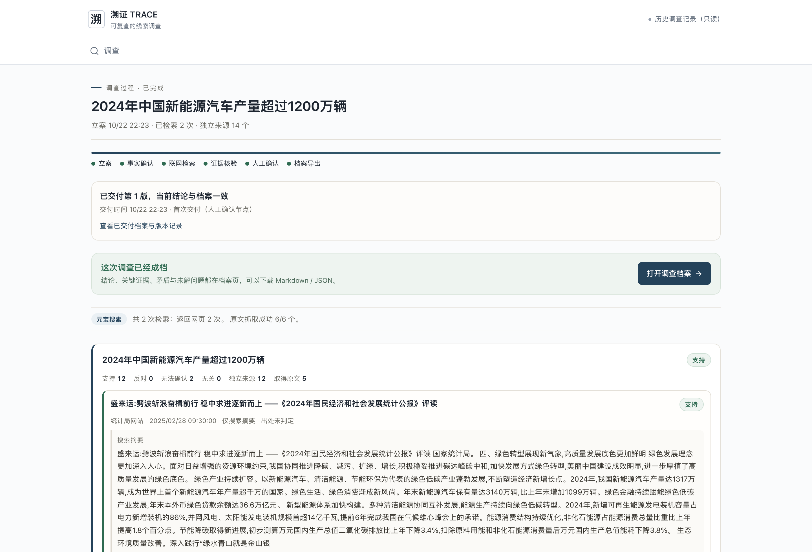
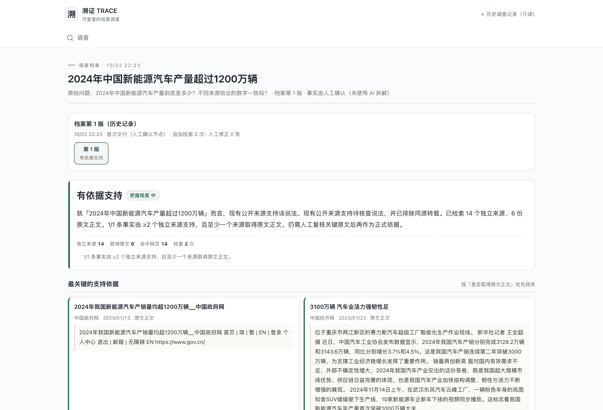

# 案例B·多来源交叉核查：2024年新能源汽车产量

溯证 TRACE · 1024侦探赛道 · 2026-10-23材料整合版

- [调查过程](https://trace-showcase-eight.vercel.app/#/cases/run_ef9af382-947a-4a9d-acd0-34b496b3d9b3)
- [调查档案](https://trace-showcase-eight.vercel.app/#/archive/run_ef9af382-947a-4a9d-acd0-34b496b3d9b3)
- 运行：run_ef9af382-947a-4a9d-acd0-34b496b3d9b3

## 原始问题

2024年中国新能源汽车产量到底是多少？不同来源给出的数字一致吗？

待核查说法：2024年中国新能源汽车产量超过1200万辆

## 规则判断与依据

**有依据支持**

就「2024年中国新能源汽车产量超过1200万辆」而言，现有公开来源支持该说法。现有公开来源支持待核查说法，并已执行同源检测，来源独立性仍待核对。已检索 9 个未检测到重复的来源簇、6 份原文正文。1/1 条事实由 ≥2 个未检测到重复的来源簇支持，且至少一个来源取得原文正文。仍需人工复核关键原文后再作为正式依据。

检索 2 次，命中 14 条网页，取得 6 份网页正文；9 个来源簇未检测到重复。这些数量不代表已经证明来源独立。

- 2024年中国新能源汽车产量超过1200万辆：规则关系“支持”；支持12、反对0、无法确认2、无关0。

## 调查说明

比较同一年份的产量、销量与统计口径，来源若共同转引原机构发布的数据，不把网站数量当成多份独立证明。本案例没有被保留为相反关系的来源，不宣称真实冲突裁决已验收。

## 元宝搜索请求记录

- 2024年 中国 新能源汽车 产量 万辆：HTTP 200，返回10条，耗时1914ms；RequestId 8f52fa20-dd88-4530-a465-56f54f74c39b。
- 2024年 新能源汽车 产销 统计数据：HTTP 200，返回10条，耗时772ms；RequestId 8bccba33-0610-4645-9aed-5d1f83fe7a13。

## 来源与关键摘录

- [2024年我国新能源汽车产销量均超1200万辆__中国政府网](https://www.gov.cn/yaowen/liebiao/202501/content_6998270.htm)
  中国政府网 · 2025/01/13 21:03:00 · 二次报道或转载 · 正文已取 · 规则关系：支持
  摘录：2024年我国新能源汽车产销量均超1200万辆__中国政府网 首页 | 简 | 繁 | EN | 登录 个人中心 退出 | 邮箱 | 无障碍 EN https://www.gov.cn/
- [3100万辆 汽车业活力强韧性足](https://www.ce.cn/xwzx/gnsz/gdxw/202501/23/t20250123_39275048.shtml)
  中国经济网 · 2025/01/23 06:13:00 · 二次报道或转载 · 正文已取 · 规则关系：支持
  摘录：位于重庆市两江新区的赛力斯汽车超级工厂智能化生产作业现场。 新华社记者 王全超摄 近日，中国汽车工业协会发布数据显示，2024年我国汽车产销分别完成3128.2万辆和3143.6万辆，同比分别增长3.7%和4.5%。这是我国汽车产销连续第二年突破3000万辆，为支撑工业经济稳增长发挥了重要作用。 销量再创新高 面对国内有效需求不足、外部不确定性增大，2024年我国汽车产业交出的这份答卷，既是我国超大规模市场优势、供应链日益完善的体现，也是我国汽车产业加快结构调整、韧性与活力不断增强的展现。 2024年11月14日上
- [2024年中国汽车产销均超3100万辆 再创新高](https://www.cnr.cn/2013qcpd/hy/20250119/t20250119_527045853.shtml)
  央广网 · 2025/01/19 09:33:58 · 网页正文 · 出处未确认 · 规则关系：支持
  摘录：2024���й�������������3100���� �ٴ��¸�_����� ��ҳ > ��������� > ����ͷ�� 2024���й�������������3100���� �ٴ��¸� 2025-01-19 09:33:58 ��Դ���й������� �й�������ҵЭ��(�³ơ�����Э��)13�շ���������ʾ��2024�꣬�й��
- [连续十年领跑全球!新能源汽车产销数量破1200万辆](https://news.cctv.cn/2025/01/13/ARTIYkIzMrp14wXMCw6pxm1f250113.shtml)
  央视网 · 2025/01/13 14:32:22 · 二次报道或转载 · 正文已取 · 规则关系：支持
  摘录：原标题： 正在加载 在中国汽车工业协会最新发布的2024年汽车工业数据中， 新能源汽车产销数量均突破1200万辆，连续十年位居世界首位。 最新数据显示，2024年，新能源汽车产销分别完成1288.8万辆和1286.6万辆，同比分别增长34.4%和35.5%，新能源新车销量达到汽车新车总销量的40.9%，继续成为中国汽车工业的重要增长点。同时，2024年新能源汽车出口128.4万辆，较上年增长6.7%，继续领跑全球。 （总台央视记者 罗宏进） 编辑：罗萌 责任编辑：刘亮 点击收起全文
- [中国汽车产销连续16年居全球首位](https://www.cnr.cn/2013qcpd/yc/20250118/t20250118_527044912.shtml)
  央广网 · 2025/01/18 08:44:09 · 网页正文 · 出处未确认 · 规则关系：支持
  摘录：�ף�����Դ���������������1000������ȫ����ף�����ȫ�����585.9����������ȫ��������ھ�����2024�꣬�й�������ҵ������д�°��˳ɼ��� ����1��13�գ��й�������ҵЭ��ٰ��¶ȷ����ᣬ������2024��12�¼�ȫ��������ҵ�ɼ�����չ��2025�꣬����ЭԤ�ƣ�2025������������Ϊ3290������ͬ������4.7%������Դ�����Խ����ָ����

## DeepSeek辅助语义复核

本案例未调用模型。不能用D案例的成功替代本案例的语义核验。

## 人工确认与交付

- 2026-10-22T14:23:48.230Z：本机操作者。填写值不是身份认证。
- 已交付4版；原始档案在在线档案页按版本下载。

## 缺口与功能限制

- 「2024年中国新能源汽车产量超过1200万辆」有 3 条来源可能同源但无法确认，还缺能证明其独立性的信息。
- 模型失败、超时、Schema异常和取消尚未逐项通过真实DeepSeek调用验收。事实拆解仍人工，追问或修正后不自动沿用旧模型意见。

本材料为已完成真实调查的历史记录说明，不是此刻重新搜索或调用模型。事实拆解由人工完成，来源独立性未经证明。页面和说明校正旧系统措辞，不改写原始证据、原始模型返回和旧档案。原始档案保留当时文字，不应把“未检测到重复”理解为已证明相互独立。

## 页面截图

