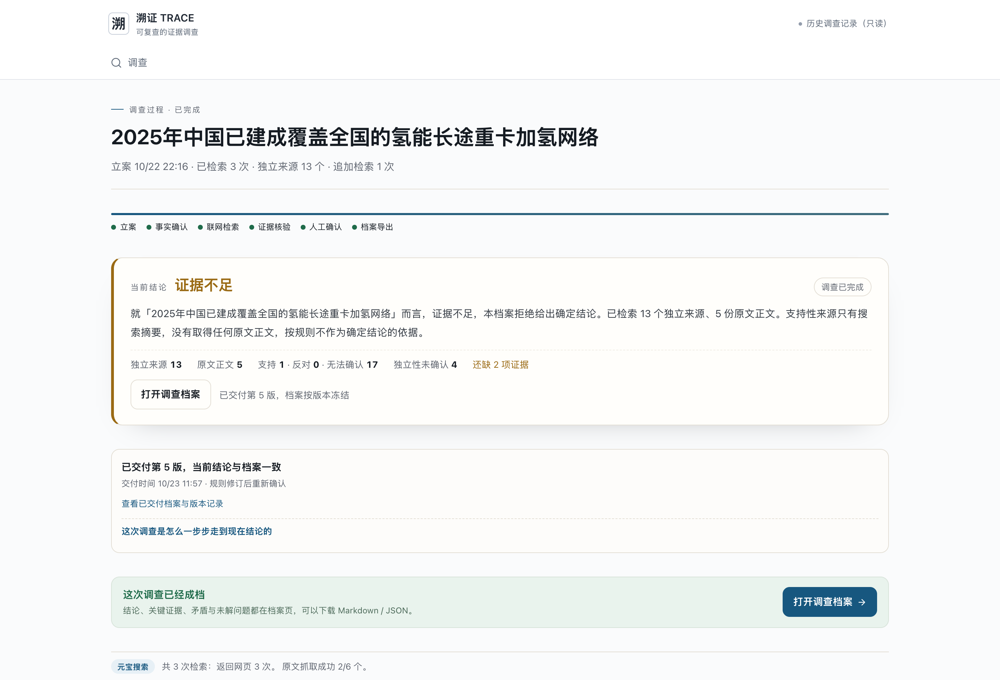
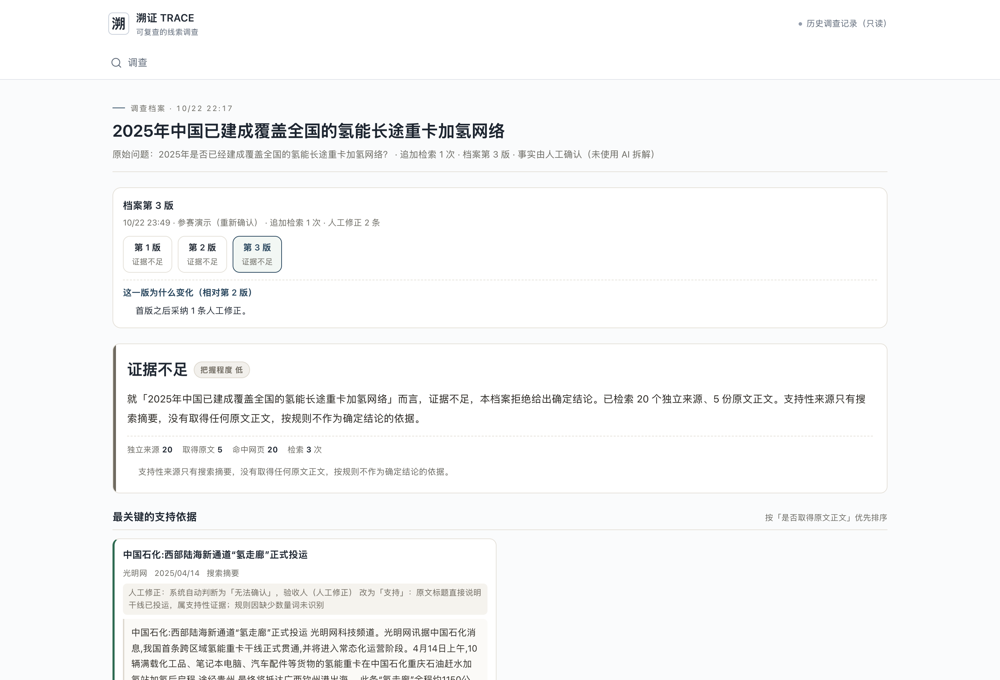

# 案例C·证据不足与继续追问：全国氢能重卡加氢网络

溯证 TRACE · 1024侦探赛道 · 2026-10-23材料整合版

- [调查过程](https://trace-showcase-eight.vercel.app/#/cases/run_d34a959a-e748-4208-b9a6-eac33c1de13a)
- [调查档案](https://trace-showcase-eight.vercel.app/#/archive/run_d34a959a-e748-4208-b9a6-eac33c1de13a)
- 运行：run_d34a959a-e748-4208-b9a6-eac33c1de13a

## 原始问题

2025年是否已经建成覆盖全国的氢能长途重卡加氢网络？

待核查说法：2025年中国已建成覆盖全国的氢能长途重卡加氢网络

## 规则判断与依据

**证据不足**

就「2025年中国已建成覆盖全国的氢能长途重卡加氢网络」而言，证据不足，本档案拒绝给出确定结论。已检索 13 个未检测到重复的来源簇、5 份原文正文。支持性来源只有搜索摘要，没有取得任何原文正文，按规则不作为确定结论的依据。

检索 3 次，命中 20 条网页，取得 5 份网页正文；13 个来源簇未检测到重复。这些数量不代表已经证明来源独立。

- 2025年中国已建成覆盖全国主要干线的氢能长途重卡加氢网络：规则关系“支持”；支持1、反对0、无法确认17、无关2。

## 调查说明

初始材料多为局部线路或氢走廊投运报道。追加全国覆盖检索并保留人工修正后，结论仍为证据不足。把局部投运标为支持的人工记录保留原样，但它不能证明全国网络已建成。

## 元宝搜索请求记录

- 2025年 全国 氢能 重卡 加氢网络 建成：HTTP 200，返回10条，耗时2901ms；RequestId 19b9c7a5-2ef5-4a4a-9774-d72a81f6b835。
- 全国加氢站 覆盖 干线 重卡：HTTP 200，返回10条，耗时934ms；RequestId 7e82a785-75b2-46ef-88a2-6db9162f636d。
- 追加：全国 加氢站 数量 2025年 建成 覆盖 高速公路；HTTP 200，返回10条；RequestId 9076fb24-42b0-4baf-bc17-307d4c62abe6。

## 来源与关键摘录

- [1150公里!国内首条,正式投运!](https://news.qq.com/rain/a/20250415A027S200)
  腾讯新闻 · 2025/04/15 08:55:31 · 二次报道或转载 · 正文已取 · 规则关系：无法确认
  摘录：1150公里！国内首条，正式投运！ 黄河新闻网吕梁 2025-04-15 08:55 发布于 山西 山西黄河新闻网传媒有限责任公司吕梁分公司官方账号 科技日报记者 操秀英 4月14日，记者从中国石化获悉， 我国首条跨区域氢能重卡干线当日正式贯通，并将进入常态化运营阶段。 此条“氢走廊”全程约1150公里，中途设有4座加氢站， 将带动重庆、贵州、广西周边中短途支线物流应用场景，是我国西部地区氢能产业发展迈出的重要一步，对加快建设经济、高效、便捷、绿色、安全的西部陆海新通道具有重要意义。 西部陆海新通道“氢走廊”是我国
- [我国首条跨区域氢能重卡干线投运](https://www.rmzxb.com.cn/c/2025-04-25/3713775.shtml)
  人民政协网 · 2025/04/25 15:08:00 · 二次报道或转载 · 正文已取 · 规则关系：无法确认
  摘录：首页 > 专题 > 双碳中国 能源担当 > 要闻 我国首条跨区域氢能重卡干线投运 2025年04月25日 15:08 | 来源： 人民日报 分享到： 14日，10辆满载化工品、笔记本电脑、汽车配件等货物的氢能重卡，在中国石化重庆石油赶水加氢站加氢后启程，途经贵州，驶向广西钦州港。这标志着我国首条跨区域氢能重卡干线投运，并将进入常态化运营阶段。 这条西部陆海新通道“氢走廊”全程约1150公里，一期中途设有重庆赶水加氢站、贵阳综保加氢站、百色伟鑫加氢站、南宁振兴加氢站等4座加氢站，由中国石化承建，形成稳定供氢网络。沿线
- [我国氢气年产能超5100万吨](https://www.ce.cn/cysc/newmain/yc/jsxw/202608/t20260812_3142606.shtml)
  中国经济网 · 2026/08/12 07:53:00 · 二次报道或转载 · 正文已取 · 规则关系：无法确认
  摘录：[字号 大 中 小 ] 科技日报北京8月11日电 （记者刘园园）11日，国家能源局发布的《中国氢能发展报告2026》（以下简称《报告》）显示，截至2025年底，我国氢气产能超5100万吨／年，同比增长约1.4％；当年氢气产量超3900万吨，同比增长约7.3％；我国可再生能源制氢产能占全球53％。 我国氢能产业规模持续扩增。《报告》显示，截至2025年底，我国煤制氢、天然气制氢、甲醇制氢产能分别为2850万吨／年、1050万吨／年、60万吨／年，产量分别为2300万吨、790万吨、40万吨；工业副产氢产能超1100万
- [氢能基建务必守好环境安全底线](https://www.news.cn/energy/20260408/9733b780d2e245679269773bd377c4a9/c.html)
  新华网 · 2026/04/08 16:41:11 · 二次报道或转载 · 正文已取 · 规则关系：无法确认
  摘录：色燃料等新增长点。这为氢能基础设施建设按下了快进键。 &emsp;&emsp;有报告显示，目前全国各地已规划或建设中的可再生能源电解水制氢项目超600个；截至2025年底，全国累计建成加氢站631座，数量居全球第一。同时，我国在氢能制取、储运和利用全链条上掌握了关键技术，已成为全球可再生能源制氢的“领头羊”。 &emsp;&emsp;然而，随着氢能基础设施建设步伐加快，潜在的环境影响已不容忽视，必须防患于未然。近几年来，挪威、美国、韩国等国家相继发生过氢气站爆炸事故，导致部分气体泄漏和环境污染。 &emsp;&em
- [中国石化:西部陆海新通道“氢走廊”正式投运](https://tech.gmw.cn/ny/2025-04/14/content_37965410.htm)
  光明网 · 2025/04/14 17:36:00 · 仅搜索摘要 · 原文未取得 · 规则关系：支持
  摘录：中国石化:西部陆海新通道“氢走廊”正式投运 光明网科技频道。光明网讯据中国石化消息,我国首条跨区域氢能重卡干线正式贯通,并将进入常态化运营阶段。4月14日上午,10辆满载化工品、笔记本电脑、汽车配件等货物的氢能重卡在中国石化重庆石油赶水加氢站加氢后启程,途经贵州,最终将抵达广西钦州港出海。 此条“氢走廊”全程约1150公里,中途设有4座加氢站,将带动重庆、贵州、广西周边中短途支线物流应用场景,是我国西部地区氢能产业发展迈出的重要一步,对加快建设经济、高效、便捷、绿色、安全的西部陆海新通道具有重要意义。 西部陆海新通

## DeepSeek辅助语义复核

本案例未调用模型。不能用D案例的成功替代本案例的语义核验。

## 人工确认与交付

- 2026-10-22T14:17:08.937Z：验收脚本（人工确认节点由脚本代为记录，不是身份认证）。填写值不是身份认证。
- 已交付6版；原始档案在在线档案页按版本下载。
- 人工修正：验收人（人工修正）改为“支持”，原因：原文标题直接说明干线已投运，属支持性证据；规则因缺少数量词未识别。原始判断与证据保留。
- 人工修正：本机操作者改为“无关”，原因：该文是面向「十五五」的展望性报道，没有给出2025年已建成的表述，与本事实无关。原始判断与证据保留。

## 缺口与功能限制

- 「2025年中国已建成覆盖全国主要干线的氢能长途重卡加氢网络」只有搜索摘要，还缺可访问的原文正文。
- 「2025年中国已建成覆盖全国主要干线的氢能长途重卡加氢网络」只有一个未检测到重复的来源簇，还需要第二个互不转载的来源。
- 模型失败、超时、Schema异常和取消尚未逐项通过真实DeepSeek调用验收。事实拆解仍人工，追问或修正后不自动沿用旧模型意见。

本材料为已完成真实调查的历史记录说明，不是此刻重新搜索或调用模型。事实拆解由人工完成，来源独立性未经证明。页面和说明校正旧系统措辞，不改写原始证据、原始模型返回和旧档案。原始档案保留当时文字，不应把“未检测到重复”理解为已证明相互独立。

## 页面截图

