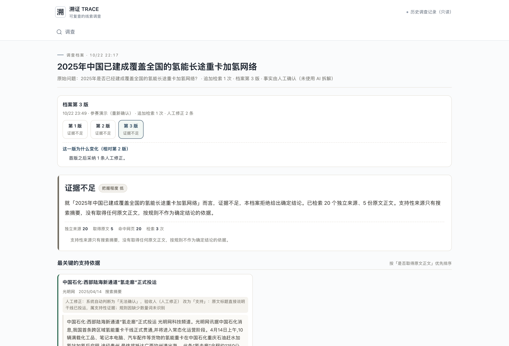

# 案例C·进阶调查报告：一条氢能说法为什么查不下去

2026-10-23 · 同版材料，历史记录回放

- [调查过程](https://trace-showcase-eight.vercel.app/#/cases/run_d34a959a-e748-4208-b9a6-eac33c1de13a)
- [在线档案：6个版本](https://trace-showcase-eight.vercel.app/#/archive/run_d34a959a-e748-4208-b9a6-eac33c1de13a)

## 调查目标与关键范围

核查2025年中国是否已建成覆盖全国的氢能长途重卡加氢网络。年份、全国覆盖与已建成必须同时得到支持；某条干线或某个走廊投运无法证明完整主张。

## 多步调查与版本变化

| 版本 | 规则结论 | 未检测到重复的簇 | 网页正文 | 追加检索 | 人工修正 |
| --- | --- | --- | --- | --- | --- |
| 1 | 证据不足 | 15 | 2 | 0 | 0 |
| 2 | 证据不足 | 20 | 5 | 1 | 1 |
| 3 | 证据不足 | 20 | 5 | 1 | 2 |
| 4 | 证据不足 | 17 | 5 | 1 | 2 |
| 5 | 证据不足 | 13 | 5 | 1 | 2 |
| 6 | 证据不足 | 13 | 5 | 1 | 2 |

计数是对应版本的规则记录；归并口径曾经调整，数量减少不能直接理解为证据消失，更不代表来源独立性已被证明。旧档案没有改写。

## 实际追加检索

- 全国 加氢站 数量 2025年 建成 覆盖 高速公路；返回10条，RequestId 9076fb24-42b0-4baf-bc17-307d4c62abe6。

## 人工修正保留与适用边界

- 验收人（人工修正）：改为“支持”，原因“原文标题直接说明干线已投运，属支持性证据；规则因缺少数量词未识别”。
- 本机操作者：改为“无关”，原因“该文是面向「十五五」的展望性报道，没有给出2025年已建成的表述，与本事实无关”。
其中对局部氢走廊投运的支持判断，是历史人工记录；它不能扩大成全国覆盖的证据。保留这条记录是为了复查人工判断，不宣称修正必然更准确。

## 最新结论与仍缺什么

第6版：证据不足。

- 「2025年中国已建成覆盖全国主要干线的氢能长途重卡加氢网络」只有搜索摘要，还缺可访问的原文正文。
- 「2025年中国已建成覆盖全国主要干线的氢能长途重卡加氢网络」只有一个未检测到重复的来源簇，还需要第二个互不转载的来源。

需要与全国覆盖范围、建成时间直接对应的可访问原始资料；共同转引同一发布机构的报道不得简单重复计数。

## 真实来源

- [中国石化:西部陆海新通道“氢走廊”正式投运](https://tech.gmw.cn/ny/2025-04/14/content_37965410.htm)
  光明网 · 2025/04/14 17:36:00 · 仅搜索摘要 · 原文未取得 · 规则关系：支持
  摘录：中国石化:西部陆海新通道“氢走廊”正式投运 光明网科技频道。光明网讯据中国石化消息,我国首条跨区域氢能重卡干线正式贯通,并将进入常态化运营阶段。4月14日上午,10辆满载化工品、笔记本电脑、汽车配件等货物的氢能重卡在中国石化重庆石油赶水加氢站加氢后启程,途经贵州,最终将抵达广西钦州港出海。 此条“氢走廊”全程约1150公里,中途设有4座加氢站,将带动重庆、贵州、广西周边中短途支线物流应用场景,是我国西部地区氢能产业发展迈出的重要一步,对加快建设经济、高效、便捷、绿色、安全的西部陆海新通道具有重要意义。 西部陆海新通
- [【信息参考】绿色转型进行时!点赞2025年这些物流低碳实践](https://news.hubeidaily.net/pc/c_5010736.html)
  湖北日报 · 2026/01/12 15:35:20 · 仅搜索摘要 · 原文未取得 · 规则关系：无法确认
  摘录：【信息参考】绿色转型进行时!点赞2025年这些物流低碳实践 湖北日报。【信息参考】绿色转型进行时!点赞2025年这些物流低碳实践 一、我国首条跨区域氢能重卡干线投运 2025年4月14日,10辆满载化工品、笔记本电脑、汽车配件等货物的氢能重卡,在中国石化重庆石油赶水加氢站加氢后启程,途经贵州,驶向广西钦州港。这标志着我国首条跨区域氢能重卡干线投运,并将进入常态化运营阶段。这条西部陆海新通道“氢走廊”全程约1150公里,一期中途设有重庆赶水加氢站、贵阳综保加氢站、百色伟鑫加氢站、南宁振兴加氢站等4座加氢站,由中国石化
- [1150公里!我国首条,正式投运!](https://www.toutiao.com/article/7493126036998062607/)
  今日头条 · 2025/04/14 19:35:09 · 仅搜索摘要 · 原文未取得 · 规则关系：无法确认
  摘录：1150公里!我国首条,正式投运! - 今日头条 今日头条。1150公里!我国首条,正式投运! 2025-04-14 19:35 · 科技日报 ◎ 科技日报记者 操秀英 4月14日,记者从中国石化获悉, 我国首条跨区域氢能重卡干线当日正式贯通,并将进入常态化运营阶段。 此条“氢走廊”全程约1150公里,中途设有4座加氢站,将带动重庆、贵州、广西周边中短途支线物流应用场景,是我国西部地区氢能产业发展迈出的重要一步,对加快建设经济、高效、便捷、绿色、安全的西部陆海新通道具有重要意义。 图片来源:中国石化 西部陆海新通道
- [我国首条跨区域氢能重卡干线投运](https://m.people.cn/n4/2025/0415/c125-21603130.html)
  人民网 · 2025/04/15 06:13:00 · 仅搜索摘要 · 原文未取得 · 规则关系：无法确认
  摘录：我国首条跨区域氢能重卡干线投运 人民网。本报北京4月14日电 (记者丁怡婷、庞革平、王欣悦)14日,10辆满载化工品、笔记本电脑、汽车配件等货物的氢能重卡,在中国石化重庆石油赶水加氢站加氢后启程,途经贵州,驶向广西钦州港。这标志着我国首条跨区域氢能重卡干线投运,并将进入常态化运营阶段。 这条西部陆海新通道“氢走廊”全程约1150公里,一期中途设有重庆赶水加氢站、贵阳综保加氢站、百色伟鑫加氢站、南宁振兴加氢站等4座加氢站,由中国石化承建,形成稳定供氢网络。沿线经过的重庆长寿、贵州六盘水、广西百色等地氢能资源丰富,电解
- [1150公里!国内首条,正式投运!](https://news.qq.com/rain/a/20250415A027S200)
  腾讯新闻 · 2025/04/15 08:55:31 · 二次报道或转载 · 正文已取 · 规则关系：无法确认
  摘录：1150公里！国内首条，正式投运！ 黄河新闻网吕梁 2025-04-15 08:55 发布于 山西 山西黄河新闻网传媒有限责任公司吕梁分公司官方账号 科技日报记者 操秀英 4月14日，记者从中国石化获悉， 我国首条跨区域氢能重卡干线当日正式贯通，并将进入常态化运营阶段。 此条“氢走廊”全程约1150公里，中途设有4座加氢站， 将带动重庆、贵州、广西周边中短途支线物流应用场景，是我国西部地区氢能产业发展迈出的重要一步，对加快建设经济、高效、便捷、绿色、安全的西部陆海新通道具有重要意义。 西部陆海新通道“氢走廊”是我国
- [西部陆海“氢走廊”正式投运](https://www.tibet.cn/cn/Instant/news/202504/t20250415_7780174.html)
  中国西藏网 · 2025/04/15 09:17:00 · 仅搜索摘要 · 原文未取得 · 规则关系：无法确认
  摘录：西部陆海“氢走廊”正式投运 中国西藏网。光明日报北京4月14日电 记者张翼从中国石化获悉,我国首条跨区域氢能重卡干线14日正式贯通,并将进入常态化运营阶段。这条西部陆海“氢走廊”始于重庆,途经贵州,最终抵达广西钦州港,全程约1150公里,中途设有4座加氢站,将带动重庆、贵州、广西周边中短途支线物流应用场景,是我国西部地区氢能产业发展迈出的重要一步。 西部陆海“氢走廊”是我国首条以氢能重卡为核心的干线物流通道,一期的4座加氢站全部为中国石化承建,形成稳定供氢网络。此条“氢走廊”沿线经过的重庆长寿、贵州六盘水、广西百色

## 方法边界

本C案例没有模型调用，DeepSeek能力展示在独立D案例中。

本材料为已完成真实调查的历史记录说明，不是此刻重新搜索或调用模型。事实拆解由人工完成，来源独立性未经证明。页面和说明校正旧系统措辞，不改写原始证据、原始模型返回和旧档案。原始档案保留当时文字，不应把“未检测到重复”理解为已证明相互独立。

## 当前页面

