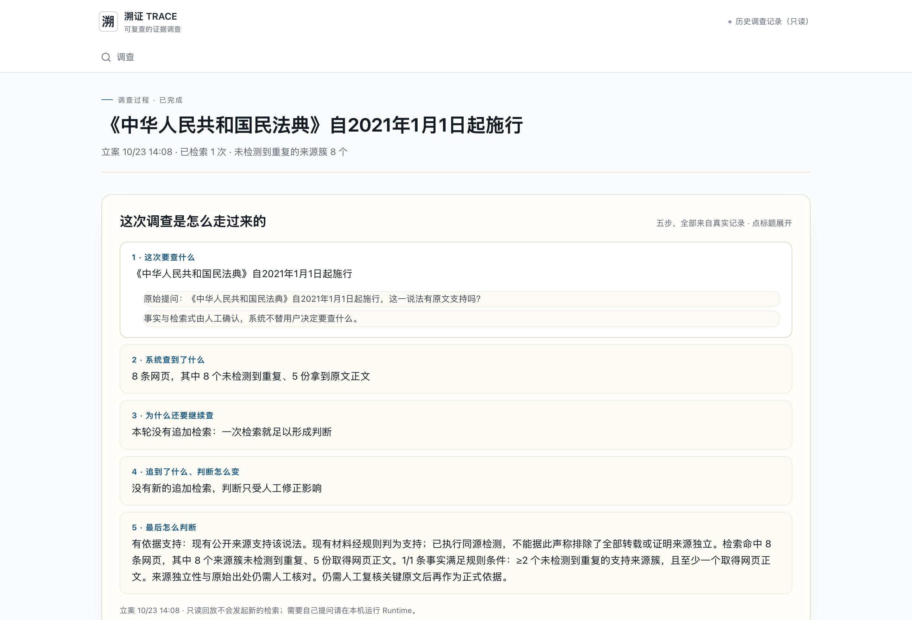
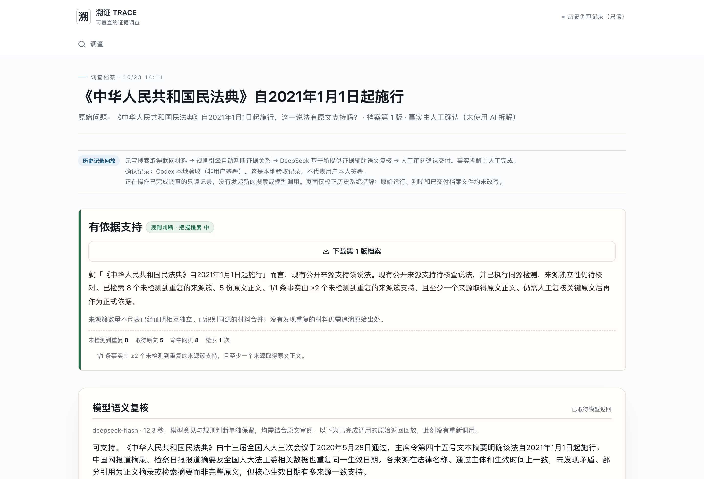

> 历史过程材料：其中版本号、旧站链接、截图与视频记录对应当时版本。当前入口、正式案例结论及更正版以《TRACE-最终交付说明.md》（2026-10-25）为准。

# 案例D·模型辅助复核：民法典施行日期

溯证 TRACE · 1024侦探赛道 · 2026-10-23材料整合版

- [调查过程](https://trace-showcase-eight.vercel.app/#/cases/run_895b5bfe-69f8-4878-ab41-af4fc3f3fe82)
- [调查档案](https://trace-showcase-eight.vercel.app/#/archive/run_895b5bfe-69f8-4878-ab41-af4fc3f3fe82)
- 运行：run_895b5bfe-69f8-4878-ab41-af4fc3f3fe82

## 原始问题

《中华人民共和国民法典》自2021年1月1日起施行，这一说法有原文支持吗？

待核查说法：《中华人民共和国民法典》自2021年1月1日起施行

## 规则判断与依据

**有依据支持**

就「《中华人民共和国民法典》自2021年1月1日起施行」而言，现有公开来源支持该说法。现有公开来源支持待核查说法，并已执行同源检测，来源独立性仍待核对。已检索 8 个未检测到重复的来源簇、5 份原文正文。1/1 条事实由 ≥2 个未检测到重复的来源簇支持，且至少一个来源取得原文正文。仍需人工复核关键原文后再作为正式依据。

检索 1 次，命中 8 条网页，取得 5 份网页正文；8 个来源簇未检测到重复。这些数量不代表已经证明来源独立。

- 《中华人民共和国民法典》自2021年1月1日起施行：规则关系“支持”；支持7、反对0、无法确认1、无关0。

## 调查说明

真实元宝搜索后，将问题、人工确认事实及真实摘录交给DeepSeek辅助复核。规则、模型意见和人工确认分别记录，不以规则通过替代模型返回。

## 元宝搜索请求记录

- 《中华人民共和国民法典》自2021年1月1日起施行：HTTP 200，返回10条，耗时2046ms；RequestId 3dd27bbf-8ec4-46f1-9712-a707492d1511。

## 来源与关键摘录

- [民法典获通过 中国特色社会主义法治建设进入新时期](https://news.cnr.cn/native/gd/20200529/t20200529_525109450.shtml)
  央广网 · 2020/05/29 11:59:00 · 二次报道或转载 · 正文已取 · 规则关系：支持
  摘录：2020-05-29 11:59:00 来源：中国网 中国网5月28日讯 （记者谢露莹）今天，十三届全国人大三次会议表决通过了《中华人民共和国民法典》（以下简称“民法典”）。这部法律自2021年1月1日起施行。 民法典（草案）通过后，广大代表委员纷纷热议，一致认为，这充分体现了党的十九届四中全会精神，彰显了中国共产党一切为了人民的初心和使命。 民法典的颁布，为民事权利提供全面保障 法律是治国之重器，良法是善治之前提。 “随着民法典的颁布实施，老百姓在物权、合同、人格、婚姻家庭以及继承等各个方面都将得到全方位的保护，
- [十三届全国人大三次会议在京闭幕](http://www.npc.gov.cn/npc/c2/c30834/202005/t20200528_306386.html)
  中国人大网 · 2020/05/28 22:10:00 · 二次报道或转载 · 正文已取 · 规则关系：支持
  摘录：大 中 小 2020年05月28日 22:10 十三届全国人大三次会议在京闭幕 批准政府工作报告、全国人大常委会工作报告等 通过《中华人民共和国民法典》&ensp;&ensp;习近平签署主席令予以公布 通过全国人民代表大会关于建立健全香港特别行政区维护国家安全的法律制度和执行机制的决定 习近平李克强汪洋王沪宁赵乐际韩正王岐山等在主席台就座 栗战书主持并讲话 新华社北京5月28日电&ensp;第十三届全国人民代表大会第三次会议在圆满完成各项议程后，28日下午在人民大会堂闭幕。大会批准政府工作报告、全国人大常委会工作报
- [全国人民代表大会常务委员会 法制工作委员会关于2020年 备案审查工作情况的报告](http://www.npc.gov.cn/c2/c30834/202101/t20210127_309939.html)
  中国人大网 · 2021/01/27 09:15:00 · 二次报道或转载 · 正文已取 · 规则关系：支持
  摘录：备案审查工作情况的报告_中国人大网 当前位置： 首页 全国人民代表大会常务委员会 法制工作委员会关于2020年 备案审查工作情况的报告 ——2021年1月20日在第十三届全国人民代表大会常务委员会第二十五次会议上 全国人大常委会法制工作委员会主任 沈春耀 来源： 中国人大网 浏览字号： 大 中 小 2021年01月27日 09:15 全国人民代表大会常务委员会： 现将2020年开展备案审查工作的情况报告如下，请审议。 对行政法规、地方性法规、司法解释等规范性文件开展备案审查，是宪法和法律赋予全国人大常委会的一项重要
- [中華人民共和國主席令(第四十五號)](https://big5.www.gov.cn/gate/big5/www.gov.cn/xinwen/2020-05/28/content_5515756.htm)
  中国政府网 · 2020/05/28 21:09:00 · 原始依据候选 · 出处未证实 · 规则关系：支持
  摘录：中華人民共和國主席令（第四十五號）_滾動新聞_中國政府網 首頁 | 簡 | 繁 | EN | 登錄 個人中心 退出 | 郵箱 | 無障礙 EN https://www.gov.cn/
- [全国人大常委会:高质高效立法助力全面依法治国](http://www.npc.gov.cn/c2/c30834/202102/t20210219_310075.html)
  中国人大网 · 2021/02/19 08:47:00 · 二次报道或转载 · 正文已取 · 规则关系：无法确认
  摘录：12件，通过有关法律问题和重大问题的决定12件。立法工作交出了一份令人满意的答卷。 立法节奏加快制定修改法律分量重 凡是党中央部署的、改革开放需要的、人民群众期盼的，就是全国人大常委会重点抓紧谋划安排的。 2020年，全国人大常委会紧跟党中央决策部署，在大事要事上担当尽责。尤其在积极助力疫情防控、完善香港特别行政区宪制、助力打好“三大攻坚战”等方面积极作为，立法工作开创了新局面，取得了新进展新成效。 2020年，全国人大常委会制定了香港特别行政区维护国家安全法，对香港特别行政区维护国家安全制度机制作出法律化、规范化

## DeepSeek辅助语义复核

真实调用：deepseek-flash，12330ms；实际返回5条引用。搜索与模型请求分别记录。

以下为模型原始返回，未经改写：

可支持。《中华人民共和国民法典》由十三届全国人大三次会议于2020年5月28日通过，主席令第四十五号文本摘要明确该法自2021年1月1日起施行；中国网报道摘录、检察日报报道摘要及全国人大法工委相关数据也重复同一生效日期。各来源在法律名称、通过主体和生效时间上一致，未发现矛盾。部分引用为正文摘录或检索摘要而非完整原文，但核心生效日期有多来源一致支持。

### 模型实际引用

- [中华人民共和国主席令(第四十五号)](http://www.npc.gov.cn/npc/c2/c30834/202005/t20200528_306382.html)
  提供给模型的摘录：对应事实：fact-1；仅搜索摘要，未取得此段原文；发布时间：2020/05/28 21:09:00；来源独立性：unique；
中华人民共和国主席令(第四十五号) 中国人大网。新华社北京5月28日电 中华人民共和国主席令 第四十五号 《中华人民共和国民法典》已由中华人民共和国第十三届全国人民代表大会第三次会议于2020年5月28日通过,现予公布,自2021年1月1日起施行。 中华人民共和国主席 习近平 2020年5月28日...
- [民法典获通过 中国特色社会主义法治建设进入新时期](https://news.cnr.cn/native/gd/20200529/t20200529_525109450.shtml)
  提供给模型的摘录：对应事实：fact-1；由检索链接取得的正文摘录（非全文，最终跳转地址未记录，原始出处待人工核对）；发布时间：2020/05/29 11:59:00；来源独立性：unique；
2020-05-29 11:59:00 来源：中国网 中国网5月28日讯 （记者谢露莹）今天，十三届全国人大三次会议表决通过了《中华人民共和国民法典》（以下简称“民法典”）。这部法律自2021年1月1日起施行。 民法典（草案）通过后，广大代表委员纷纷热议，一致认为，这充分体现了党的十九届四中全会精神，彰显了中国共产党一切为了人民的初心和使命。 民法典的颁布，为民事权利提供全面保障 法律是治国之重器，良法是善治之前提。 “随着民法典的颁布实施，老百姓在物权、合同、人格、婚姻家庭以及继承等各个方面都将得到全方位的保护，而经济社会的发展和老百姓的幸福生活也将能够得到更加有力的法治保障。”全国人大代表、广东省律师协会会长肖胜方说。 全国人大代表、全国人大宪法和法律委员会委员、中国社会
- [《中华人民共和国民法典》明年1月1日起正式施行_中华人民共和国最高人民检察院](https://www.spp.gov.cn/spp/zdgz/202006/t20200602_463827.shtml)
  提供给模型的摘录：对应事实：fact-1；仅搜索摘要，未取得此段原文；发布时间：2020/06/02 12:20:00；来源独立性：unique；
时间:2020-06-02 作者:陆青 来源:检察日报 本报北京6月1日电(见习记者陆青) 6月1日,新华社受权播发《中华人民共和国民法典》。该法典于5月28日由十三届全国人大三次会议表决通过,国家主席习近平签署第45号主席令予以公布。 民法典共7编、1260条,各编依次为总则、物权、合同、人格权、婚姻家庭、继承、侵权责任和附则,自2021年1月1日起施行,婚姻法、继承法、民法通则、收养法、担保法、合同法、物权法、侵权责任法、民法总则同时废止。 民法典是新中国第一部以法典命名的法律,开创了我国法典编纂立法的先河,具有里程碑意义。编纂民法典是党的十八届四中全会确定的一项重大政治任务和立法任务,是以习近平同志为核心的党中央作出的重大法治建设部署。 民法典系统整合了新中国70多年来长期实践形成的民事法律规范,汲取了中华民族5000多年优秀法律文化,借鉴了人类法治文明建设有益成果,是一部体现我国社会主义性质、符合人民利益和愿望、顺应时代发展要求的民法典,是一部体现对生命健康、财产安全、交易便利、生活幸福、人格尊严等各方面权利平等保护的民法典,是一部具有鲜明中国特色、实践特色、时代特色的民法典。 检察机关要对照习近平总书记在中央政治局第二十次集体学习时就“切实实施民法典”提出的要求,以及就加强民事检察工作提出的具体要求,采取针对性的举措。要以高度的政治自觉、法治自觉和检察自觉推动民法典的正确统一实施,把民法典作为工具书,推动“四大检察”全面协调充分发展。 最高人民检察院 (100726)北京市东城区北河沿大街147号010-65209114(查号台) 010-12309(检察服务热线)...
- [法工委发言人:我国现行有效法律共274件](http://www.npc.gov.cn/c2/c30834/202101/t20210119_309745.html)
  提供给模型的摘录：对应事实：fact-1；仅搜索摘要，未取得此段原文；发布时间：2021/01/19 16:26:00；来源独立性：unique；
法工委发言人:我国现行有效法律共274件 中国人大网。《中国人大》全媒体记者徐航 周誉东1月19日北京报道:随着《中华人民共和国民法典》自2021年1月1日起施行,9部民事法律同时废止,如今我国现行有效的法律共有多少件?1月18日,全国人大常委会法工委发言人、研究室主任臧铁伟对此作了回应。 臧铁伟介绍,2020年全国人大及其常委会制定法律9件,修改法律12件,通过有关法律问题和重大问题的决定12件。民法典从今年1月1日起施行,婚姻法、继承法、民法通则、收养法、担保法、合同法、物权法、侵权责任法、民法总则等9部民事法律已同时废止。我国现行有效法律数量发生较大变化,目前共274件。其中,宪法1件,按法律部门分类,还有宪法相关法46件、民法商法23件、行政法92件、经济法75件、社会法25件、刑法1件、诉讼与非诉讼程序法11件。宪法和5个宪法修正案计为1件;刑法、11个刑法修正案和全国人大常委会关于惩治骗购外汇、逃汇和非法买卖外汇犯罪的决定计为1件;每件法律无论修改几次均计为1件。 臧铁伟还介绍说,法制工作委员会将根据全国人大及其常委会立法工作情况,定期统计更新有关立法数据,请大家及时关注中国人大网法制工作委员会主页发布的信息。...
- [十三届全国人大三次会议在京闭幕](http://www.npc.gov.cn/npc/c2/c30834/202005/t20200528_306386.html)
  提供给模型的摘录：对应事实：fact-1；由检索链接取得的正文摘录（非全文，最终跳转地址未记录，原始出处待人工核对）；发布时间：2020/05/28 22:10:00；来源独立性：unique；
大 中 小 2020年05月28日 22:10 十三届全国人大三次会议在京闭幕 批准政府工作报告、全国人大常委会工作报告等 通过《中华人民共和国民法典》&ensp;&ensp;习近平签署主席令予以公布 通过全国人民代表大会关于建立健全香港特别行政区维护国家安全的法律制度和执行机制的决定 习近平李克强汪洋王沪宁赵乐际韩正王岐山等在主席台就座 栗战书主持并讲话 新华社北京5月28日电&ensp;第十三届全国人民代表大会第三次会议在圆满完成各项议程后，28日下午在人民大会堂闭幕。大会批准政府工作报告、全国人大常委会工作报告等。大会通过《中华人民共和国民法典》，国家主席习近平签署第45号主席令公布这部法律。大会通过全国人民代表大会关于建立健全香港特别行政区维护国家安全的法律制度和执行机制的决定。 闭幕会由大会主

## 人工确认与交付

- 2026-10-23T06:11:20.994Z：Codex 本地验收（非用户签署）。本地验收，非用户本人签署。
- 已交付1版；原始档案在在线档案页按版本下载。

## 缺口与功能限制

- 规则未列出额外缺口，原始出处和来源依赖仍需人工核对。
- 模型失败、超时、Schema异常和取消尚未逐项通过真实DeepSeek调用验收。事实拆解仍人工，追问或修正后不自动沿用旧模型意见。

本材料为已完成真实调查的历史记录说明，不是此刻重新搜索或调用模型。事实拆解由人工完成，来源独立性未经证明。页面和说明校正旧系统措辞，不改写原始证据、原始模型返回和旧档案。原始档案保留当时文字，不应把“未检测到重复”理解为已证明相互独立。

## 页面截图

